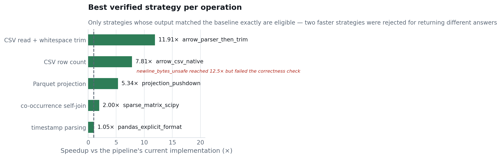
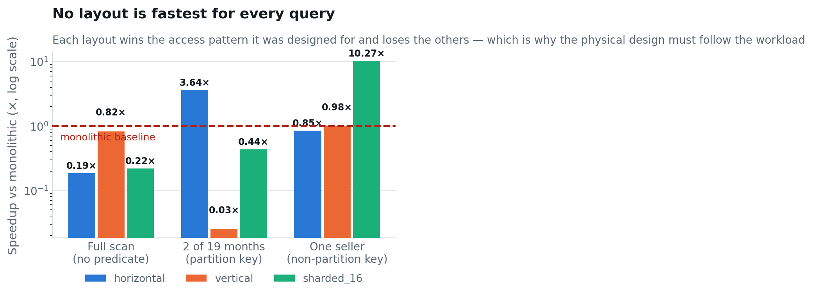
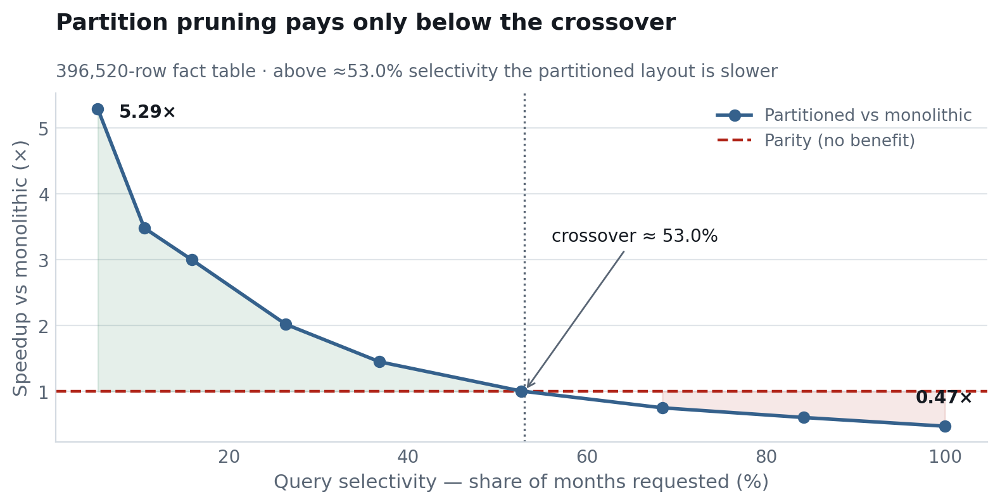
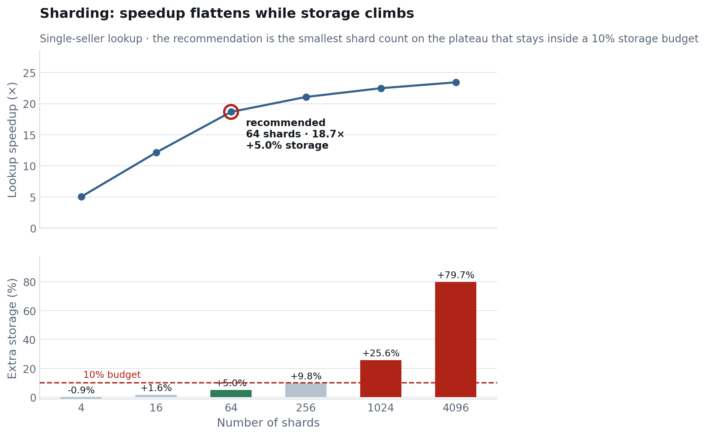
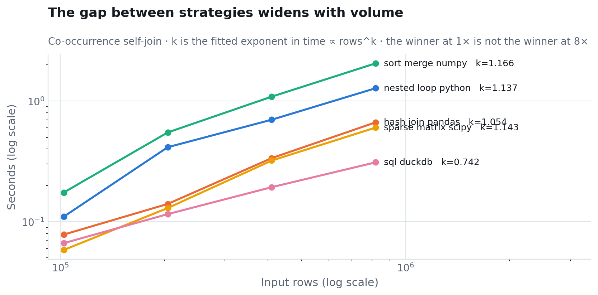

# Pipeline optimisation study

Measured comparison of alternative implementations and physical storage
layouts for this pipeline's expensive operations. The study answers three
questions for each operation: which strategy is fastest, whether the fastest
one is still correct, and at what data volume the choice begins to matter.

Reproduce with `make bench`. Every figure and table below is generated from
`reports/benchmarks/results.json`; none of the numbers are typed by hand.

## How to read these numbers

- **Measured:** 2026-10-21T08:26:09+00:00 on Linux-6.8.0-138-generic-x86_64-with-glibc2.35, Python 3.10.12, pandas 2.3.3.
- **Trials:** 5 measured runs per strategy after one discarded warm-up, reported as the median. Min and max are kept so the spread is visible.
- **Two numbers here are less stable than the rest.** The crossover point is a ratio of measurements a few tens of milliseconds long, and five runs of this study put it at 49%, 52%, 53%, 53% and 57% — treat it as *around half the table*. The shard recommendation moves between 64 and 256 for the same reason; those two are not reliably distinguishable on this machine, and 64 costs half the storage.
- **What does not move:** every correctness verdict, all bytes-read and storage figures (measured from the filesystem rather than a timer), the sign and rough magnitude of every speedup, the fitted scaling exponents, and which strategy wins each workload.
- **Page cache is warm.** Timings are therefore relative costs between strategies on one machine, not predictions of cold-start or cluster behaviour.
- **Bytes read is the cache-independent measure** and is reported alongside time wherever a layout is involved. It is computed by summing the sizes of exactly those files a query opens.
- **Peak heap counts Python allocations only.** A strategy that allocates inside Arrow or DuckDB shows a near-zero figure; that means the allocation happened outside Python's allocator, not that it was free.
- **Every strategy's output is compared against the baseline's.** A faster strategy that returns a different answer is reported as a rejected candidate, never as a win.

## Headline results

| Finding | Measurement |
|---|---|
| Fast reader on the real cleaning stage | **1.27×** (1.74s → 1.37s), all 6 processed tables identical |
| Partition pruning at tightest selectivity | **5.29×**, 98.6% less data read |
| Partition pruning on a full scan | **0.47×** — slower than monolithic |
| Crossover selectivity | **≈53.0%** of the table |
| Hash sharding, single-seller lookup | **18.7×** at 64 shards (+5.0% storage) |
| Materialising every stage vs pipelining | **625% slower**, buys restartability |
| Co-occurrence join, best at 8× volume | **6.63×** spread between strategies (`sql_duckdb` fastest) |

## 1. Strategy comparison per operation

Each operation below is implemented several ways on identical input. The first
strategy listed is what the pipeline does today, and every speedup is quoted
against it.

### co-occurrence self-join

*Concept exercised:* Join methods J1-J4; vectorised vs interpreted execution

| Strategy | Median (ms) | Spread (ms) | Speedup | Peak heap (MiB) | Correctness | Note |
|---|---|---|---|---|---|---|
| nested_loop_python | 88.35 | 6.85 | 1.00 | 7.38 | baseline | Current pipeline implementation. |
| hash_join_pandas | 63.15 | 3.75 | 1.40 | 18.52 | verified |  |
| sort_merge_numpy | 147.36 | 5.75 | 0.6000 | 11.77 | verified | Pair generation is vectorised but the per-basket loop is not. |
| sparse_matrix_scipy | 44.20 | 6.53 | 2.00 | 8.41 | verified |  |
| sql_duckdb | 60.64 | 17.77 | 1.46 | 0.9100 | verified | Plan chosen by a cost-based optimiser, not by us. |

**Result: `sparse_matrix_scipy` at 2.00×.**

### CSV row count

*Concept exercised:* Scan cost; correctness under quoted newlines

| Strategy | Median (ms) | Spread (ms) | Speedup | Peak heap (MiB) | Correctness | Note |
|---|---|---|---|---|---|---|
| csv_reader_python | 111.55 | 6.84 | 1.00 | 0.0000 | baseline |  |
| arrow_csv_native | 14.28 | 3.81 | 7.81 | 0.0000 | verified |  |
| newline_bytes_unsafe | 8.96 | 0.1300 | 12.45 | 0.0000 | **wrong answer** | Fastest and wrong: counts newlines inside quoted review text as row terminators, overcounting this file. |

**Result: `arrow_csv_native` at 7.81×.**
 `newline_bytes_unsafe` was faster still at 12.45× but returned a different answer and is therefore not a candidate.

### CSV read + whitespace trim

*Concept exercised:* Columnar in-memory layout; vectorisation; measure before optimising

| Strategy | Median (ms) | Spread (ms) | Speedup | Peak heap (MiB) | Correctness | Note |
|---|---|---|---|---|---|---|
| read_string_then_trim | 312.17 | 15.79 | 1.00 | 58.81 | baseline | Current pipeline read path. |
| read_object_then_trim | 306.28 | 29.53 | 1.02 | 62.12 | verified |  |
| read_arrow_then_trim | 250.45 | 55.67 | 1.25 | 8.36 | verified | Identical trim code; only the dtype the CSV was read into differs. |
| read_arrow_detect_skip | 235.08 | 48.03 | 1.33 | 8.36 | verified | No Olist column carries padding, so this skips the trim entirely. |
| arrow_parser_then_trim | 26.20 | 4.65 | 11.91 | 0.0500 | verified |  |

**Result: `arrow_parser_then_trim` at 11.91×.**

### timestamp parsing

*Concept exercised:* Avoiding per-value interpretation; Arrow kernels

| Strategy | Median (ms) | Spread (ms) | Speedup | Peak heap (MiB) | Correctness | Note |
|---|---|---|---|---|---|---|
| pandas_inferred | 10.17 | 1.04 | 1.00 | 1.52 | baseline |  |
| pandas_explicit_format | 9.67 | 0.4900 | 1.05 | 1.52 | verified |  |
| arrow_strptime | 12.57 | 0.8200 | 0.8090 | 0.8600 | verified |  |

**Result: `pandas_explicit_format` at 1.05×.**

### Parquet projection

*Concept exercised:* Projection pushdown; columnar storage

| Strategy | Median (ms) | Spread (ms) | Speedup | Peak heap (MiB) | Correctness | Note |
|---|---|---|---|---|---|---|
| read_all_columns | 48.14 | 12.81 | 1.00 | 39.45 | baseline |  |
| projection_pushdown | 9.01 | 4.81 | 5.34 | 10.04 | verified | Reads 2 of 12 columns; the rest are never decompressed. |

**Result: `projection_pushdown` at 5.34×.**



## 2. The optimisation that was landed

Of the verified wins above, one was promoted into the pipeline: the raw CSV
read path can parse with Arrow instead of pandas, behind the
`ECOM_FAST_READER` flag (`Settings.fast_reader`, default off). Both paths run
from one codebase so the baseline remains reproducible.

- Component speedup, orders table read: measured in section 1 above.
- **Whole cleaning stage: 1.74s → 1.37s = 1.27×.**
- Row counts identical: yes.
- Every processed table identical value-by-value: yes.

| Processed table | Rows | Identical to baseline |
|---|---|---|
| orders | 99,441 | yes |
| order_lines | 102,425 | yes |
| order_products | 102,425 | yes |
| products | 32,951 | yes |
| customers | 99,441 | yes |
| sellers | 3,095 | yes |

The component speedup is much larger than the stage speedup, and the gap is
the point: the read is only part of what cleaning does, so Amdahl's law caps
what optimising it alone can deliver. This is why the study measures whole
stages and not just the functions that looked slow in a profile.

### A correction to an earlier measurement

An earlier note in this project recorded a 16.9× speedup for `trim_whitespace`
from "pyarrow-backed string dtype". That figure does not reproduce as a
property of the trim function. Measured across all six raw tables, the trim
touches 2,390,364 string cells and costs about 231 ms in total, and converting
columns to Arrow inside the transform is roughly break-even. The real effect
belongs to the **read path**: parsing into Arrow-backed storage rather than
pandas `string` storage is what makes the subsequent `.str.strip()` a native
kernel pass. The optimisation is therefore a reader configuration, not a
transform rewrite, which is why it was landed in `StorageBackend.get_csv_arrow`
rather than in `trim_whitespace`.

## 3. Fragmentation and sharding

Written at 4× the real fact table (396,520 rows). At the real 99,130 rows every query finishes in about ten
milliseconds, where timer noise is a large fraction of the measurement.

### Storage cost of each layout

| Layout | Files | Bytes | Overhead vs monolithic (%) |
|---|---|---|---|
| monolithic | 1 | 42,502,057 | 0.0000 |
| horizontal | 19 | 33,951,219 | -20.10 |
| vertical | 2 | 44,112,050 | 3.80 |
| sharded_16 | 16 | 43,166,414 | 1.60 |

### Query cost per layout

Three queries, chosen so that each layout is both favoured and punished:

- **Full scan** — no predicate; nothing can be pruned.
- **2 of 19 months** — a predicate on the horizontal partition key.
- **One seller** — a predicate on a column no range partition covers.

| Query | Layout | Seconds | Bytes read | Speedup | Bytes saved (%) | Correct |
|---|---|---|---|---|---|---|
| total_revenue | monolithic | 0.0033 | 42,502,057 | 1.00 | 0.0000 | yes |
| total_revenue | horizontal | 0.0175 | 33,951,219 | 0.1860 | 20.10 | yes |
| total_revenue | vertical | 0.0040 | 25,331,522 | 0.8250 | 40.40 | yes |
| total_revenue | sharded_16 | 0.0148 | 43,166,414 | 0.2200 | -1.60 | yes |
| two_month_revenue | monolithic | 0.0232 | 42,502,057 | 1.00 | 0.0000 | yes |
| two_month_revenue | horizontal | 0.0064 | 1,479,572 | 3.64 | 96.50 | yes |
| two_month_revenue | vertical | 0.9125 | 44,112,050 | 0.0250 | -3.80 | yes |
| two_month_revenue | sharded_16 | 0.0530 | 43,166,414 | 0.4370 | -1.60 | yes |
| seller_revenue | monolithic | 0.0695 | 42,502,057 | 1.00 | 0.0000 | yes |
| seller_revenue | horizontal | 0.0818 | 33,951,219 | 0.8500 | 20.10 | yes |
| seller_revenue | vertical | 0.0708 | 25,331,522 | 0.9820 | 40.40 | yes |
| seller_revenue | sharded_16 | 0.0068 | 3,308,201 | 10.27 | 92.20 | yes |



The matrix is the argument against a default answer. Horizontal fragmentation
by month is the best layout for a month predicate and among the worst for a
seller predicate; hash sharding on `seller_id` is the exact mirror.

**Vertical fragmentation is rejected, for a sharper reason than being slow.**
It genuinely helps a query that stays inside the hot fragment, since that
fragment is smaller than the whole table. But Parquet already prunes columns
without being asked, so the monolithic file offers the same saving for free —
and the moment a query spans the split, the rejoin costs a 40-fold
penalty. The layout buys nothing the format does not already provide and adds
a catastrophic failure mode.

### Selectivity: where pruning stops paying

| Months | Selectivity (%) | Rows matched | Monolithic (s) | Partitioned (s) | Speedup | Bytes saved (%) |
|---|---|---|---|---|---|---|
| 1 | 5.30 | 6,844 | 0.0199 | 0.0038 | 5.29 | 98.60 |
| 2 | 10.50 | 17,376 | 0.0219 | 0.0063 | 3.48 | 96.50 |
| 3 | 15.80 | 26,880 | 0.0258 | 0.0086 | 3.00 | 94.70 |
| 5 | 26.30 | 54,608 | 0.0270 | 0.0134 | 2.02 | 89.20 |
| 7 | 36.80 | 88,212 | 0.0267 | 0.0184 | 1.45 | 82.50 |
| 10 | 52.60 | 154,584 | 0.0283 | 0.0281 | 1.01 | 69.20 |
| 13 | 68.40 | 233,808 | 0.0282 | 0.0375 | 0.7520 | 53.50 |
| 16 | 84.20 | 319,136 | 0.0296 | 0.0488 | 0.6050 | 36.30 |
| 19 | 100.00 | 396,520 | 0.0266 | 0.0563 | 0.4730 | 20.10 |



The curve crosses parity at **≈53.0% selectivity**. Below it, pruning
removes more work than fragmentation adds; above it, the partitioned layout is
reading nearly everything anyway and pays per-file overhead 19 times
over, plus the -20.1%
extra storage the layout costs. This is the project's rule for partitioning:
partition on a column the frequent queries actually filter on, and only when
those queries are selective.

### Shard count: speedup against storage

| Shards | Lookup (s) | Speedup | Bytes read | Files | Storage overhead (%) |
|---|---|---|---|---|---|
| 1 | 0.0717 | 1.00 | 42,502,057 | 1 | 0.0000 |
| 4 | 0.0143 | 5.03 | 10,494,580 | 4 | -0.9000 |
| 16 | 0.0059 | 12.14 | 3,308,201 | 16 | 1.60 |
| 64 | 0.0038 | 18.67 | 1,051,825 | 64 | 5.00 |
| 256 | 0.0034 | 21.07 | 630,556 | 256 | 9.80 |
| 1,024 | 0.0032 | 22.48 | 227,787 | 1,024 | 25.60 |
| 4,096 | 0.0031 | 23.43 | 197,771 | 3,850 | 79.70 |



The lookup keeps getting marginally faster all the way to 4096 shards (23.4×), because the query reads one file and that file keeps shrinking. That is not the recommendation. Speedup has already reached 18.7× at 64 shards for +5.0% storage, after which it would exceed the declared storage budget, while the fastest setting costs +80% storage for the remainder. **The constrained optimum, not the maximum, is the engineering answer** — a report built on the argmax would have recommended the most expensive layout in the sweep while looking rigorous.

One caveat on this particular recommendation: 64 and 256 shards sit close enough together that the choice between them moved across runs of this study. Both are inside the storage budget; prefer 64, since the speed difference is inside the measurement noise and it costs half the extra storage.

## 4. Materialisation versus pipelining

| Approach | Seconds | Intermediate bytes | Overhead (%) | Restartable | Same answer |
|---|---|---|---|---|---|
| materialise_each_stage | 0.8330 | 43,229,464 | 625.20 | yes | yes |
| pipeline_in_memory | 0.1149 | 0 | 0.0000 | **no** | yes |

The pipeline writes Parquet between every stage, and on this three-stage
sequence that costs 625% over keeping
intermediates in memory. The cost is real and it is deliberate: materialising
is what makes a failed run resumable from the last good stage and lets the
quality gates inspect what each stage produced. The honest framing is that
this is a fixed overhead which amortises as the per-stage computation grows —
it looks worst, as here, when the stages themselves are cheap.

## 5. Scaling: does any of this matter at this size?

| Strategy | 1× | 2× | 4× | 8× |
|---|---|---|---|---|
| hash_join_pandas | 0.0781 | 0.1403 | 0.3365 | 0.6666 |
| nested_loop_python | 0.1100 | 0.4145 | 0.7007 | 1.28 |
| sort_merge_numpy | 0.1746 | 0.5497 | 1.09 | 2.06 |
| sparse_matrix_scipy | 0.0582 | 0.1297 | 0.3212 | 0.6033 |
| sql_duckdb | 0.0663 | 0.1155 | 0.1932 | 0.3104 |

Fitted exponent `k` in time ∝ rows^k:

| Strategy | k |
|---|---|
| nested_loop_python | 1.137 |
| hash_join_pandas | 1.054 |
| sort_merge_numpy | 1.166 |
| sparse_matrix_scipy | 1.143 |
| sql_duckdb | 0.742 |



At 1× the slowest and fastest strategies are 3.00× apart; at 8× they are 6.63× apart. **This is the answer to "why optimise a pipeline that already finishes in seconds":** at the project's real volume the choice of join strategy is nearly irrelevant, and the reason to measure it is that the curves diverge. `sql_duckdb` is the only strategy with a sublinear fitted exponent (0.742), because it parallelises across cores as the work grows.

A second honest result: the Python nested loop is not catastrophically slow
here, even though it is the naive implementation. Only 3.28% of Olist orders
contain two or more products, so the quadratic term in basket size almost
never fires. An optimisation's value depends on the data's shape, not only on
the algorithm's complexity class.

## 6. Strategies that were rejected

Rejected means one of two things: the strategy returned a different answer
from the baseline, or it was correct but no faster. Both are results.

| Strategy | Why it was rejected |
|---|---|
| `newline_bytes_unsafe` (CSV row count) | Reached 12.45× — the fastest in its group — but **failed the correctness check**. Fastest and wrong: counts newlines inside quoted review text as row terminators, overcounting this file. |
| `sort_merge_numpy` (co-occurrence self-join) | Correct but **slower than the baseline** at 0.60×. |
| `arrow_strptime` (timestamp parsing) | Correct but **slower than the baseline** at 0.81×. |
| Vertical fragmentation | Helps only while a query stays inside the hot fragment (0.98× on `seller_revenue`), which Parquet's own column pruning already provides for free. A query spanning the split costs 0.025× on `two_month_revenue` — a 40-fold penalty. |
| Arrow CSV reader, default options | Fast and silently wrong: Arrow reads an empty field as `""` rather than null unless `strings_can_be_null=True` is set. That converted 2,965 missing delivery dates into empty strings, which would have let the no-nulls quality gate pass on genuinely absent data. Fixed, then adopted. |

The correctness rejections above were caught only because the harness compares
every strategy's output against the baseline's. They would otherwise have
produced plausible, wrong pipelines that ran faster.

## 7. What this changes in the project

| Decision | Evidence |
|---|---|
| Keep Parquet, keep the processed layer monolithic per table | Analytical queries here scan most of the table; below the crossover there is nothing to prune. |
| Partition `fct_orders` by order month in the warehouse | Dashboard queries are month-scoped, which is the selective case pruning serves. |
| Cluster, not partition, by `seller_id` | The seller predicate cannot be pruned by a month partition; sharding showed the access pattern is worth 18.7× when the layout matches it. |
| Do not vertically fragment | Measured 0.03× worst case; the format already does it. |
| Keep materialising stages | The overhead is known and bought deliberately. |
| `ECOM_FAST_READER` available, default off | Verified identical output; left off so published figures come from the long-standing path. |

## Reproducing

```bash
make bench          # run the study, write results.json, render this report
ECOM_FAST_READER=1 make pipeline   # run the pipeline with the optimisation on
```

Figures:

- `figures/f1_selectivity_crossover.png`
- `figures/f2_volume_scaling.png`
- `figures/f3_layout_matrix.png`
- `figures/f4_shard_sweep.png`
- `figures/f5_workload_speedups.png`
